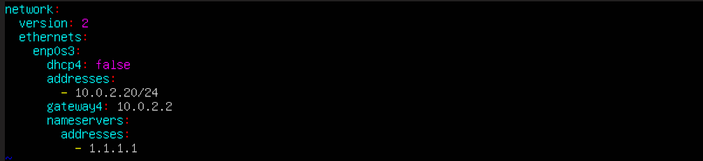
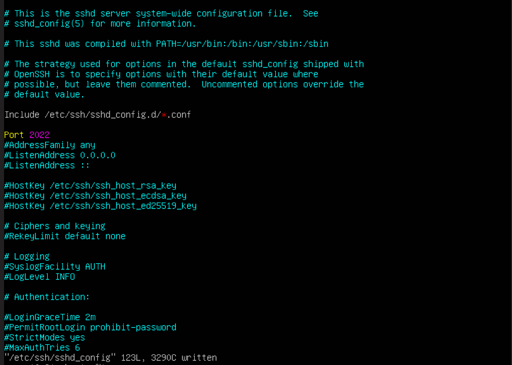
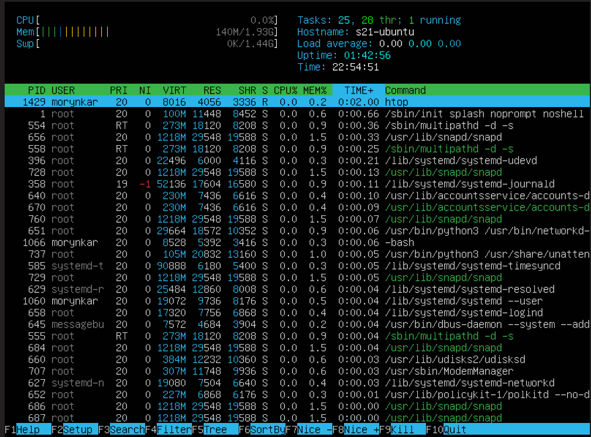

# DO1 — Linux System Administration

Практический проект по установке и базовому администрированию Ubuntu Server в изолированной виртуальной машине. Работа охватывает первоначальную настройку системы, управление доступом, конфигурацию сети и сервисов, мониторинг ресурсов, анализ журналов и автоматизацию периодических задач.


## Цель проекта

Подготовить минимальную серверную Linux-систему без графического окружения и выполнить её базовую настройку так, чтобы конфигурация сохранялась после перезагрузки и могла быть проверена стандартными системными инструментами.

## Задачи

- установить Ubuntu Server в VirtualBox;
- создать непривилегированного пользователя и настроить делегирование через `sudo`;
- настроить hostname, часовой пояс и синхронизацию времени по NTP;
- заменить DHCP-конфигурацию статическими параметрами сети и DNS;
- установить OpenSSH Server, включить автозапуск и изменить порт службы;
- исследовать процессы, загрузку CPU, память и дисковое пространство;
- проверить системные журналы и события авторизации;
- настроить периодическое выполнение команды с помощью `cron`.

## Стенд и инструменты

| Компонент | Использование |
|---|---|
| Ubuntu Server 20.04 LTS | Гостевая операционная система |
| VirtualBox | Изоляция учебного стенда |
| Netplan | Статическая конфигурация сети |
| systemd, timedatectl | Управление службами и временем |
| OpenSSH | Удалённый доступ к серверу |
| top, htop | Анализ процессов и ресурсов |
| fdisk, df, du, ncdu | Анализ дисков и файловой системы |
| syslog, auth.log | Диагностика системных событий |
| cron | Планирование периодических задач |

## Что реализовано

Система настроена со статическим IPv4-адресом, шлюзом и публичным DNS-сервером. После перезагрузки проверены адресация, маршрут по умолчанию, разрешение доменных имён и доступность внешних узлов. Служба SSH добавлена в автозагрузку и перенесена на нестандартный порт. Синхронизация времени подтверждена состоянием NTP.

Для диагностики системы исследованы процессы, загрузка процессора и памяти, разметка диска, использование файловой системы и размеры каталогов. По системным журналам проверены вход пользователя, перезапуск SSH и выполнение запланированной команды `uptime` каждые две минуты.

## Подтверждение результата

Подробный разбор выполненных настроек и проверок приведён в [техническом отчёте](docs/walkthrough.md). Скриншоты сделаны внутри изолированной виртуальной машины и фиксируют состояние стенда на момент выполнения проекта.

| Сеть | SSH | Мониторинг |
|---|---|---|
|  |  |  |

## Воспроизведение и проверка

В каталоге [`configs/`](configs/) находятся обезличенные примеры Netplan и `sshd_config`. Они предназначены для изучения: перед применением необходимо заменить имя интерфейса, адреса и проверить сетевой доступ к виртуальной машине.

Скрипт [`scripts/verify-system.sh`](scripts/verify-system.sh) выполняет только чтение состояния системы и проверяет ОС, hostname, NTP, сеть, DNS, SSH, корневую файловую систему и пользовательский crontab:

```bash
chmod +x scripts/verify-system.sh
sudo ./scripts/verify-system.sh
```

Ожидаемый SSH-порт можно переопределить без изменения скрипта:

```bash
sudo DO1_SSH_PORT=2222 ./scripts/verify-system.sh
```

## Полученные навыки

- администрирование Linux из командной строки;
- управление пользователями, группами и привилегиями;
- настройка IPv4, DNS и маршрута по умолчанию;
- управление службами и их автозапуском;
- диагностика ресурсов и чтение системных журналов;
- создание и проверка периодических заданий.

## Ограничения

Проект отражает конфигурацию локальной учебной виртуальной машины. Адреса и параметры приведены как пример и не предназначены для непосредственного применения в production. Настройки пока выполняются вручную; автоматизация развёртывания будет следующим этапом развития проекта.
