# Полный отчёт по лабораторному стенду

[← Вернуться в README](../README.md)

## Навигация

1. [Установка ОС](#part-1-установка-ос)
2. [Создание пользователя](#part-2-создание-пользователя)
3. [Настройка сети](#part-3-настройка-сети-ос)
4. [Обновление ОС](#part-4-обновление-ос)
5. [Использование sudo](#part-5-использование-команды-sudo)
6. [Синхронизация времени](#part-6-установка-и-настройка-службы-времени)
7. [Текстовые редакторы](#part-7-установка-и-использование-текстовых-редакторов)
8. [Настройка SSH](#part-8-установка-и-базовая-настройка-сервиса-sshd)
9. [Мониторинг процессов](#part-9-установка-и-использование-утилит-top-htop)
10. [Диски и разделы](#part-10-использование-утилиты-fdisk)
11. [Файловая система](#part-11-использование-утилиты-df)
12. [Размер каталогов](#part-12-использование-утилиты-du)
13. [Интерактивный анализ диска](#part-13-установка-и-использование-утилиты-ncdu)
14. [Системные журналы](#part-14-работа-с-системными-журналами)
15. [Планировщик cron](#part-15-использование-планировщика-заданий-cron)

Отчёт сохраняет последовательность выполненной лабораторной работы: цель каждого этапа, использованные команды, наблюдаемое поведение системы и подтверждающие скриншоты. Исходное учебное задание и методические материалы здесь не приводятся.

## Part 1. Установка ОС

**Цель этапа:** подготовить минимальную серверную систему без графического интерфейса. Содержимое файла `/etc/issue` позволяет проверить установленный дистрибутив и его версию непосредственно внутри виртуальной машины.

С использованием программы виртуализации **VirtualBox** была установлена операционная система **Ubuntu 20.04.6 Server LTS** без графического интерфейса.

Версию установленной системы проверил командой:

```
cat /etc/issue
```


На скриншоте показан вывод команды `cat /etc/issue` с версией установленной ОС.

---
## Part 2. Создание пользователя

**Цель этапа:** отделить повседневную работу от учётной записи, созданной при установке, и проверить управление пользователями и группами. Группа `adm` даёт доступ на чтение части системных журналов, но сама по себе не предоставляет полные права `root`.

Создал пользователя `user_1`, отличного от учётной записи, созданной при установке системы.

Для создания пользователя выполнил команду:

```bash
sudo adduser user_1
```
Затем добавил пользователя в группу `adm`:

```bash
sudo usermod -aG adm user_1
```
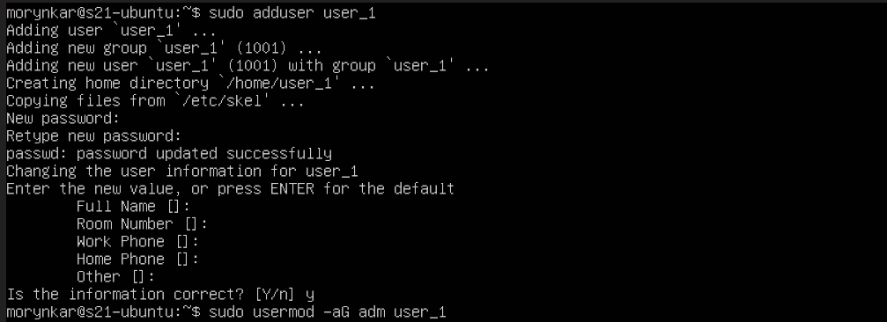

На скриншоте показаны создание пользователя `user_1` и добавление его в группу `adm`.

Принадлежность пользователя к группе `adm` проверил командой:

```bash
groups user_1
```


На скриншоте показан вывод команды `groups`, подтверждающий, что пользователь `user_1` входит в группу `adm`.

Затем наличие пользователя проверено в системном файле `/etc/passwd`:

```bash
cat /etc/passwd
```


На скриншоте показано содержимое файла `/etc/passwd` с записью нового пользователя.

В файле есть строка `user_1:x:1001:1001::/home/user_1:/bin/bash`, подтверждающая, что пользователь добавлен в систему.

---
## Part 3. Настройка сети ОС

**Цель этапа:** исследовать исходную DHCP-конфигурацию, затем заменить её постоянным IPv4-адресом, шлюзом и DNS. После перезагрузки отдельно проверяются адресация, маршрут по умолчанию, разрешение имён и доступность внешних узлов.

1. Задал имя машины `user-1`.
```bash
sudo hostnamectl set-hostname user-1
```


На скриншоте показано выполнение команды для смены имени хоста на `user-1`.

2. В редакторе Vim изменил файл `/etc/hosts`:
```bash
sudo vim /etc/hosts
```
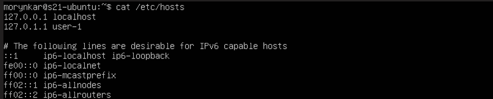

На скриншоте показано содержимое файла `/etc/hosts` с обновлённым именем машины.

3. Установил часовой пояс, соответствующий моему местоположению.
```bash
timedatectl
sudo timedatectl set-timezone Asia/Yekaterinburg
timedatectl
```
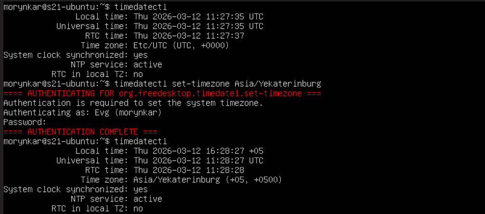

На скриншоте показаны смена часового пояса и проверка времени командой `timedatectl`.

4. Вывел названия сетевых интерфейсов с помощью консольной команды:
```bash
ip link
```
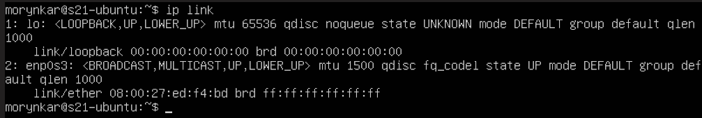

На скриншоте показан список доступных сетевых интерфейсов.

Интерфейс `lo` — виртуальный loopback-интерфейс для обмена данными внутри операционной системы без выхода в физическую сеть. Он связан с адресом `127.0.0.1` (`localhost`), автоматически создаётся при загрузке и присутствует в каждой системе Linux.

5. Получил IP-адрес устройства от DHCP-сервера с помощью консольной команды:
```bash
ip a
```
* IP-адрес, полученный по DHCP: `10.0.2.15`.


На скриншоте показаны сетевые настройки интерфейса `enp0s3`, полученные по DHCP (`10.0.2.15`).

- DHCP — сетевой протокол, позволяющий сетевым устройствам автоматически получать IP-адрес и другие параметры, необходимые для работы в сети TCP/IP.

6. Определил внешний IP-адрес и внутренний IP-адрес шлюза (маршрут по умолчанию):
```bash
ip route
curl ifconfig.me
```
* Внутренний IP-адрес шлюза: `10.0.2.2`.
* Внешний IP-адрес проверен через внешний сервис и скрыт в публичной версии.


На скриншоте показаны таблица маршрутизации (шлюз `10.0.2.2`) и запрос внешнего IP-адреса.

7. Задал статические (введённые вручную, а не полученные от DHCP-сервера) параметры IP-адреса, шлюза и DNS. Использовал публичный DNS-сервер `1.1.1.1`.

В редакторе Vim изменил файл конфигурации сети:

```bash
sudo vim /etc/netplan/00-installer-config.yaml
```
Задал следующие статические параметры:
* IP-адрес: `10.0.2.20/24`.
* Шлюз по умолчанию: `10.0.2.2`.
* DNS-сервер: `1.1.1.1`.
* DHCP отключён.


На скриншоте показан файл конфигурации со статическим IP-адресом `10.0.2.20`, шлюзом и DNS-сервером.

8. Перезагрузил виртуальную машину и проверил, что статические сетевые параметры (IP-адрес, шлюз и DNS) сохранились.

После перезагрузки убедился, что статические сетевые настройки применились и соответствуют заданным в предыдущем пункте:

``` bash
ip a
ip route
```

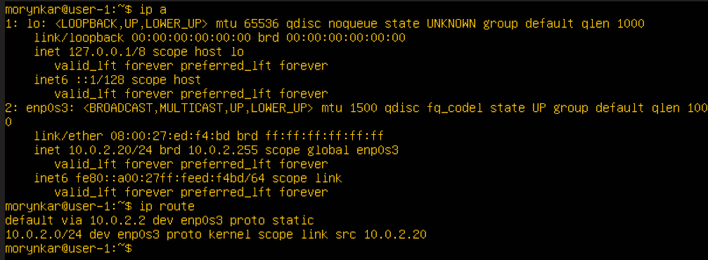

На скриншоте показана проверка статического IP-адреса и маршрута по умолчанию.

```bash
resolvectl status enp0s3
```

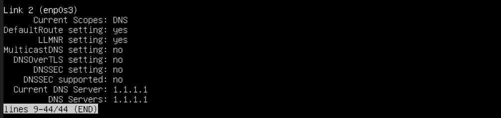

На скриншоте показана проверка настроек DNS-сервера (`1.1.1.1`).

Проверил доступность удалённых узлов `1.1.1.1` и `ya.ru` с помощью `ping`.


На скриншоте показан результат команды `ping`: потерь пакетов нет (`0% packet loss`).

---
## Part 4. Обновление ОС

**Цель этапа:** обновить индекс пакетов и установленные компоненты. Повторный запуск `apt update` подтвердил, что доступных обновлений нет.
```bash
sudo apt update
sudo apt upgrade -y
```


На скриншоте показано системное сообщение «All packages are up to date» после выполнения `apt update`.


На скриншоте показан результат `apt upgrade`, подтверждающий отсутствие доступных обновлений (`0 upgraded`).

---
## Part 5. Использование команды sudo

**Цель этапа:** делегировать административные права обычному пользователю без постоянного входа под `root`. Работу `sudo` проверил изменением имени хоста и последующей проверкой результата.
Добавил пользователя `user_1`, созданного в Part 2, в группу `sudo`:
```bash
sudo usermod -aG sudo user_1
```
Команда `sudo` позволяет обычному пользователю выполнять команды с правами суперпользователя (`root`), если у него есть соответствующие разрешения.

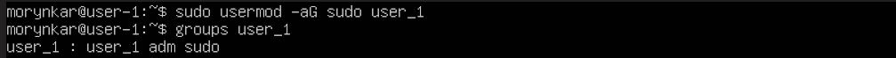

На скриншоте показано добавление пользователя `user_1` в группу `sudo` и проверка состава групп командой `groups user_1`.

От имени пользователя `user_1` изменил имя хоста с помощью `sudo`:

```bash
sudo hostnamectl set-hostname s21-ubuntu
```


На скриншоте показано изменение имени хоста пользователем `user_1`.

Затем обновил файл `/etc/hosts`:

```bash
sudo vim /etc/hosts
```

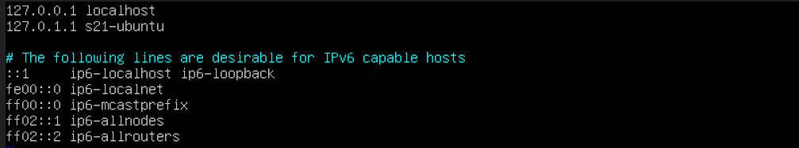

На скриншоте показано обновлённое содержимое файла `/etc/hosts` с новым именем хоста `s21-ubuntu`.

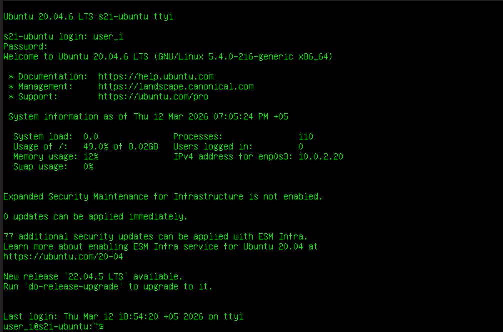

На скриншоте показано приветствие системы при входе с новым именем хоста (`s21-ubuntu`).

---
## Part 6. Установка и настройка службы времени

**Цель этапа:** включить автоматическую коррекцию системного времени. Синхронные часы важны для журналов, cron, сертификатов и сопоставления событий между узлами.

Включил автоматическую синхронизацию времени и проверил её состояние:
```bash
sudo timedatectl set-ntp true
timedatectl show
```


На скриншоте показан вывод `timedatectl show`, подтверждающий `NTPSynchronized=yes` и отображающий время в моём часовом поясе.

---
## Part 7. Установка и использование текстовых редакторов

**Цель этапа:** сравнить три консольных редактора на одинаковых операциях: создание файла, сохранение, отказ от сохранения, поиск и замена. Это необходимо для изменения конфигураций на сервере без графической среды.
Задание:
1. Установи текстовые редакторы VIM (+ любые два по желанию NANO, MCEDIT, JOE и т. д.)
2. Используя каждый из трех выбранных редакторов, создай файл test_X.txt, где X — название редактора, в котором создан файл. Напиши в нём свой никнейм, закрой файл с сохранением изменений.
3. Используя каждый из трех выбранных редакторов, открой файл на редактирование, отредактируй файл, заменив никнейм на строку «21 School 21», закрой файл без сохранения изменений.
4. Используя каждый из трех выбранных редакторов, отредактируй файл ещё раз (по аналогии с предыдущим пунктом), а затем освой функции поиска по содержимому файла (слово) и замены слова на любое другое.

Установил три текстовых редактора: Vim, Nano и mcedit.
```bash
sudo apt update
sudo apt install vim
sudo apt install nano
sudo apt install mcedit
```
В каждом редакторе создал файл и записал в него свой никнейм:

### 1. Текстовый редактор VIM
#### Создание файла и сохранение:
- Запуск:
```bash
vim test_vim.txt
```
- Для редактирования нажал клавишу `i` и ввёл никнейм `morynkar`.
- Для сохранения и выхода нажал `Esc` и ввёл команду `:wq`.


На скриншоте показаны ввод никнейма и команда `:wq` для сохранения файла в Vim.

#### Редактирование без сохранения:
- Переместил курсор к слову клавишами `h`, `j`, `k`, `l`.
- Командой `cw` (change word) заменил слово на `21 School 21`.
- Для выхода без сохранения нажал `Esc` и ввёл команду `:q!`.


На скриншоте показаны изменённое содержимое файла и команда `:q!` для выхода без сохранения.

#### Поиск и замена:
- Для поиска и замены использовал команду `:s/morynkar/word/`, которая заменяет `morynkar` на `word`.


На скриншоте показан ввод команды замены слова в Vim.

### 2. Текстовый редактор NANO
#### Создание файла и сохранение:
- Запуск:
```bash
nano test_nano.txt
```
- После редактирования нажал `Ctrl+O`, подтвердил запись в файл, затем вышел сочетанием `Ctrl+X`.


На скриншоте показано содержимое файла в редакторе Nano перед сохранением.

#### Редактирование без сохранения:
- Удалил слово клавишей `Delete` и ввёл `21 School 21`.
- Нажал `Ctrl+X` для выхода.
- Когда редактор предложил сохранить изменения, отказался сочетанием `Ctrl+N`.


На скриншоте показан изменённый текст в Nano перед закрытием без сохранения.

#### Поиск и замена:
- Для поиска и замены нажал `Ctrl+\`, ввёл искомое слово `morynkar`, затем строку замены `word` и подтвердил операцию.

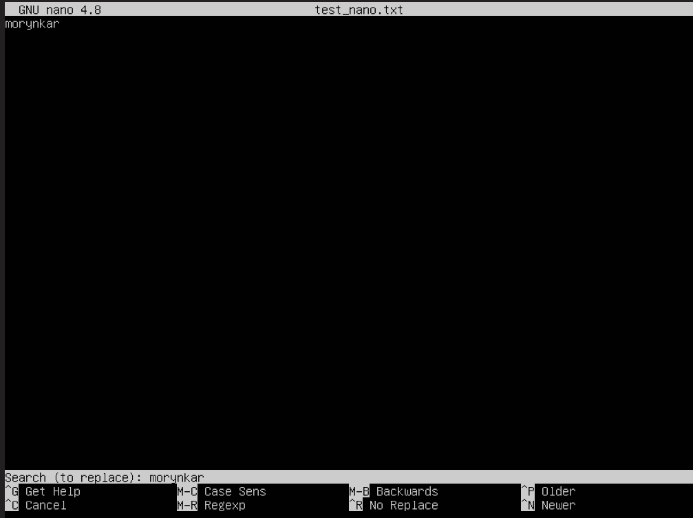

На скриншоте показан ввод слова для поиска в Nano.


На скриншоте показан ввод слова для замены в Nano.

### 3. Текстовый редактор MCEDIT
- Запуск:
```bash
mcedit test_mcedit.txt
```
- Сохранил изменения клавишей `F2` и вышел из редактора клавишей `F10`.


На скриншоте показано содержимое файла в редакторе mcedit.

#### Редактирование без сохранения:
- Удалил слово клавишей `Delete` и ввёл `21 School 21`.
- Нажал `F10` для выхода.
- Когда редактор предложил сохранить изменения, отказался, выбрав `No`.


На скриншоте показан изменённый текст в mcedit перед выходом без сохранения.

#### Поиск и замена:

Для поиска и замены нажал `F4`. В открывшемся меню ввёл `morynkar` в поле поиска и `word` в поле замены, затем подтвердил действие кнопкой `OK`. Редактор выделил найденное слово, после чего я нажал `Replace`.

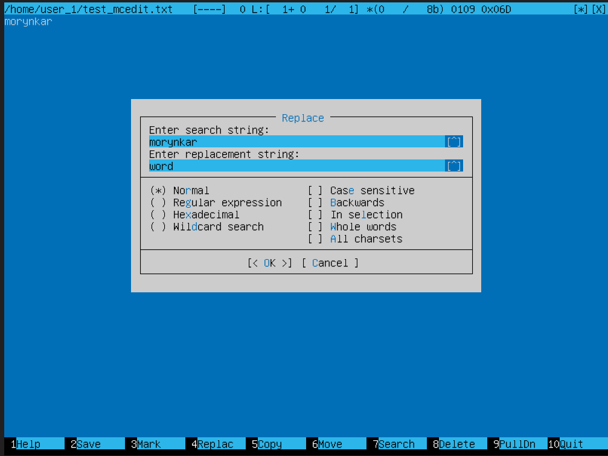

На скриншоте показано заполнение полей в окне замены mcedit.


На скриншоте показано подтверждение замены слова в mcedit.

---
## Part 8. Установка и базовая настройка сервиса SSHD

**Цель этапа:** настроить удалённое администрирование как управляемую systemd-службу. Проверяются установка, автозапуск, изменение порта, наличие процесса и прослушиваемый TCP socket.
Установил службу SSH:
```bash
sudo apt install openssh-server
```

После установки проверил статус службы командой:
```bash
sudo systemctl status ssh
```


На скриншоте показан вывод `systemctl status`, подтверждающий, что служба SSH активна (`running`).

Включил автозапуск службы SSH командой:
```bash
sudo systemctl enable ssh
```
Проверил автозапуск командой:
```bash
sudo systemctl is-enabled ssh
```
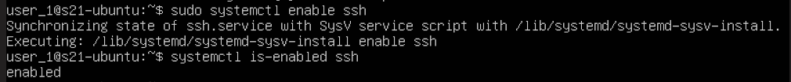

На скриншоте показаны включение автозапуска и статус `enabled`.

Чтобы изменить порт службы SSH с 22 на 2022, открыл конфигурационный файл в текстовом редакторе:
```bash
sudo vim /etc/ssh/sshd_config
```
Раскомментировал строку `# Port 22` и заменил её на `Port 2022`.

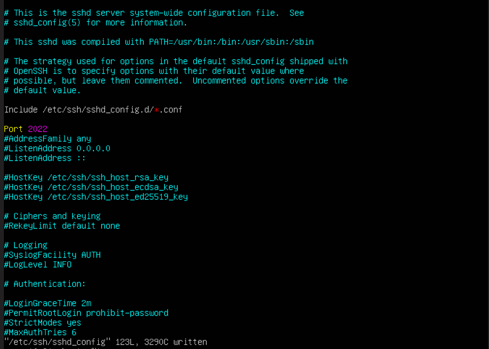

На скриншоте показано содержимое файла `sshd_config` с параметром `Port 2022`.

После изменения конфигурации перезапустил службу SSH:
```bash
sudo systemctl restart ssh
```

Наличие процесса SSH проверил командой:
```bash
ps aux | grep sshd
```
* `ps` отображает запущенные процессы.
* Ключи:
  * `a` показывает процессы всех пользователей.
  * `u` выводит подробную информацию о пользователе, запустившем процесс.
  * `x` показывает процессы, не связанные с терминалом.
* `grep sshd` ищет строки с процессом `sshd`.


На скриншоте показан вывод `ps aux`, подтверждающий работу демона `sshd`.

После перезагрузки системы выполнил команду:
```bash
netstat -tan
```
В выводе есть строка `tcp 0 0.0.0.0:2022 0.0.0.0:* LISTEN`.


На скриншоте показан вывод `netstat`, подтверждающий, что порт 2022 находится в состоянии `LISTEN`.

`netstat` отображает сетевые соединения.

Значение ключей:
* `-t` показывает TCP-соединения.
* `-a` показывает все соединения и порты, включая ожидающие подключения.
* `-n` выводит адреса и порты в числовом виде, без преобразования в доменные имена.

Значение столбцов `netstat`:
* `Proto` — используемый протокол соединения.
* `Recv-Q` — количество байтов, ожидающих чтения приложением.
* `Send-Q` — количество байтов, ожидающих отправки приложением.
* `Local Address` — локальный IP-адрес и порт, на котором работает служба.
* `Foreign Address` — удалённый IP-адрес и порт.
* `State` — текущее состояние соединения.

Основные состояния соединений:
* `LISTEN` — служба ожидает входящее соединение.
* `TIME_WAIT` — соединение завершено, система ожидает его закрытия.
* `ESTABLISHED` — соединение активно.

Адрес `0.0.0.0` означает, что служба принимает соединения на всех сетевых интерфейсах устройства.

Строка `tcp 0 0.0.0.0:2022 0.0.0.0:* LISTEN` означает, что служба использует TCP, слушает порт 2022 на всех IPv4-интерфейсах и ожидает входящих подключений.

---
## Part 9. Установка и использование утилит top, htop

**Цель этапа:** научиться находить причины нагрузки системы. `top` показывает сводные показатели и процессы, а `htop` добавляет интерактивную сортировку, поиск, фильтрацию и настройку панели.

### 1. Работа с утилитой top

Запуск `top`:
```bash
top
```

Данные из `top`:
| Параметр | Значение |
|---|---|
|uptime|1 час 13 мин|
|количество авторизованных пользователей|1|
|средняя загрузка за 1, 5 и 15 минут|0.00, 0.00, 0.00|
|общее количество процессов|92|
| Загрузка CPU в режиме user | 0.0 % |
| Загрузка CPU в режиме system | 0.0 % |
| Простой CPU (idle) | 100 % |
| Использовано памяти | 138.5 MiB |
| PID процесса с наибольшим потреблением памяти | 656 |
| PID процесса с наибольшим процессорным временем | 1 |

Сортировка процессов в `top`:
* по использованию памяти — `Shift+M`;
* по загрузке процессора — `Shift+P`.


На скриншоте показан вывод `top`, отсортированный по столбцу `%MEM` (использование памяти).


На скриншоте показан вывод `top`, отсортированный по столбцу `%CPU` (загрузка процессора).

### 2. Работа с утилитой htop

Запуск `htop`:
```bash
htop
```
Основные команды `htop`:
* `F6` — сортировка (`SortBy`);
* `F4` — фильтр (`Filter`);
* `F3` — поиск (`Search`);
* `F2` — настройки (`Setup`).


На скриншоте показаны процессы в `htop`, отсортированные по PID.


На скриншоте показаны процессы в `htop`, отсортированные по `PERCENT_CPU`.

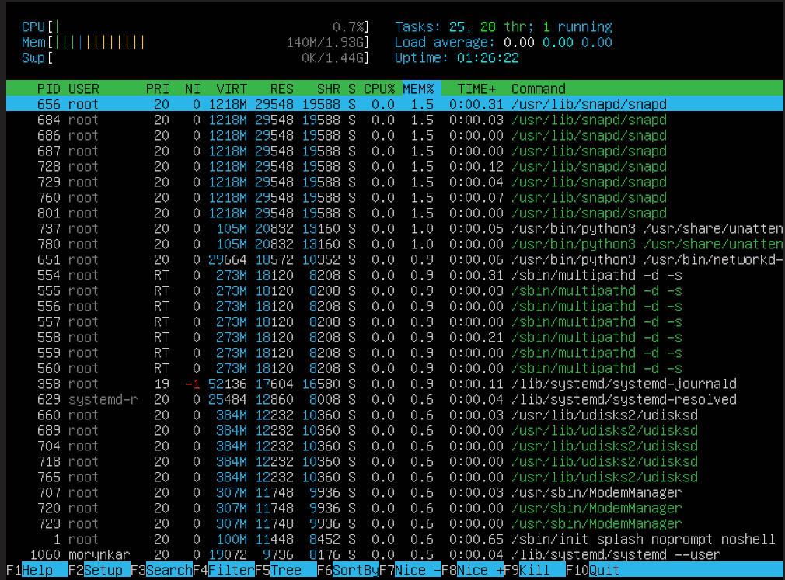

На скриншоте показаны процессы в `htop`, отсортированные по `PERCENT_MEM`.


На скриншоте показаны процессы в `htop`, отсортированные по времени работы (`TIME+`).


На скриншоте показана фильтрация списка процессов в `htop` клавишей `F4` по имени `sshd`.


На скриншоте показан результат поиска процесса `syslog` клавишей `F3`.


На скриншоте показан настроенный заголовок `htop` с полями `Hostname`, `Clock` и `Uptime`.

---
## Part 10. Использование утилиты fdisk

**Цель этапа:** получить информацию о виртуальном диске, его размере, секторах и разделах. `swapon` отдельно показывает подключённое пространство подкачки.
Запустил команду:
```bash
sudo fdisk -l
```

Определил следующие параметры диска:
* Устройство: `/dev/sda`.
* Размер: `10 GiB` (`10737418240` байт).
* Количество секторов: `20971520`.
```bash
swapon --show
```
* Размер раздела подкачки: `1.4 GiB`.

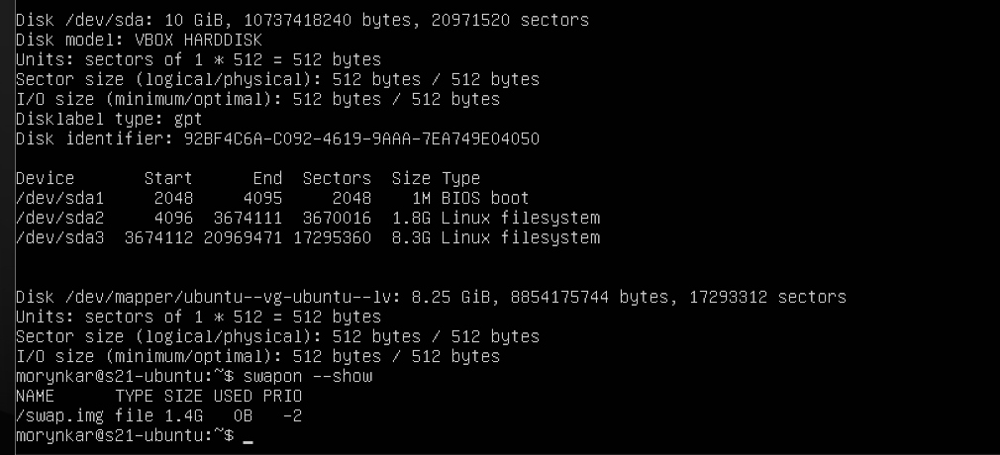

На скриншоте показан вывод `fdisk -l` с характеристиками диска `/dev/sda` и информацией о разделах.

---
## Part 11. Использование утилиты df

**Цель этапа:** определить занятое и доступное место на смонтированной корневой файловой системе. Сравниваются обычный и человекочитаемый форматы вывода, а также определяется тип файловой системы.

Запуск утилиты:
```bash
df
```
Запуск утилиты в человекочитаемом формате:
```bash
df -Th
```
| Параметр | Значение (df) | Значение (df -Th) |
| --- | --- | --- |
| Размер раздела | 8408452 (1K-blocks) | 8.1 G |
| Занято | 4132456 (1K-blocks) | 4.0 G |
| Свободно | 3827280 (1K-blocks) | 3.7 G |
| Использование | 52% | 52% |
| Тип ФС | - | ext4 |

Блок размером 1K — единица измерения дискового пространства, равная 1024 байтам (1 КиБ).


На скриншоте показан вывод команды `df` в стандартном формате.


На скриншоте показан вывод `df -Th` с типом файловой системы и размерами в гибибайтах.

---
## Part 12. Использование утилиты du

**Цель этапа:** измерить место, занимаемое конкретными каталогами и их содержимым. В отличие от `df`, команда `du` анализирует файлы и директории, а не файловую систему целиком.
Используемые ключи:
* `-s` показывает только итоговый размер;
* `-b` выводит размер в байтах;
* `-h` использует человекочитаемый формат (КиБ, МиБ, ГиБ).

Вывел размеры каталогов `/home`, `/var` и `/var/log` в байтах и человекочитаемом формате:
```bash
sudo du -sb /home
sudo du -sh /home
sudo du -sb /var
sudo du -sh /var
sudo du -sb /var/log
sudo du -sh /var/log
```
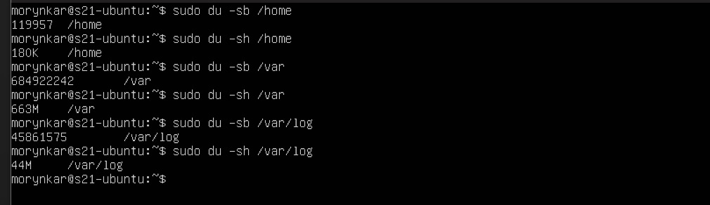

На скриншоте показаны итоговые размеры каталогов `/home`, `/var` и `/var/log` в байтах и мегабайтах.

Чтобы увидеть размер каждого вложенного элемента в `/var/log`, выполнил команды:
```bash
sudo du -sb /var/log/*
sudo du -sh /var/log/*
```
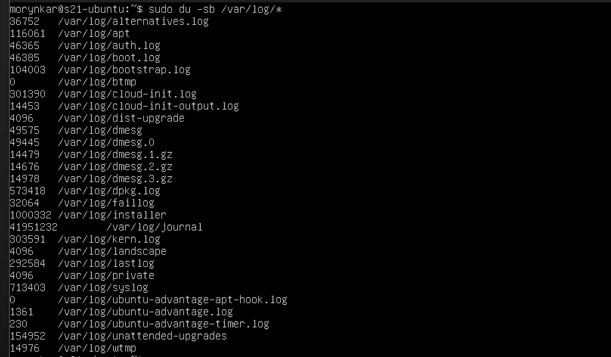

На скриншоте показаны размеры всех файлов и подкаталогов внутри `/var/log` в байтах.


На скриншоте показаны размеры вложенных элементов `/var/log` в КиБ и МиБ.

---
## Part 13. Установка и использование утилиты ncdu

**Цель этапа:** повторить анализ каталогов в интерактивном интерфейсе и сопоставить результат с `du`. Это облегчает поиск крупных файлов и подкаталогов.

Установка утилиты `ncdu`:
```bash
sudo apt install ncdu
```
Запуск утилиты:
```bash
ncdu /
```

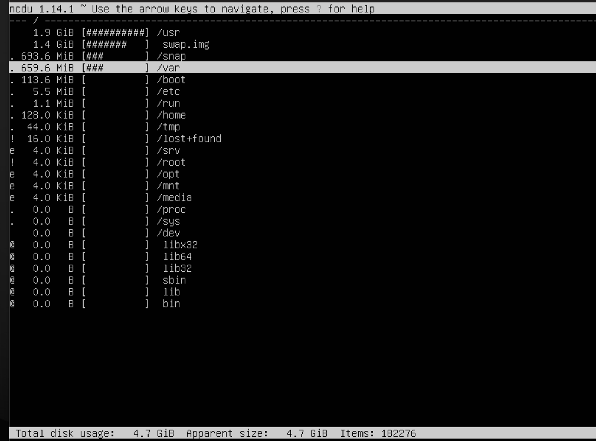

На скриншоте показано интерактивное дерево каталогов в `ncdu` с размерами `/home`, `/var` и других системных каталогов.

* С помощью клавиш управления курсором перешёл в каталог `/var/log`, чтобы посмотреть, сколько места занимает каждый файл:


На скриншоте показано содержимое `/var/log` в `ncdu`, отсортированное по размеру.

Результаты `ncdu` приблизительно совпадают с `du`: `/var` занимает около 659,6 MiB, а `/var/log` — около 43,6 MiB. Небольшая разница возможна из-за округления единиц и изменения журналов между замерами. Значение 1,4 GiB на верхнем уровне относится к `swap.img`, а не к каталогу `/var`.

---
## Part 14. Работа с системными журналами

**Цель этапа:** найти сведения о загрузке ядра, общесистемных событиях и авторизации. После перезапуска SSH запись в журнале подтверждает, что действие действительно обработано systemd.

Для удобного просмотра журналов использовал `less`:

```bash
less /var/log/dmesg
```

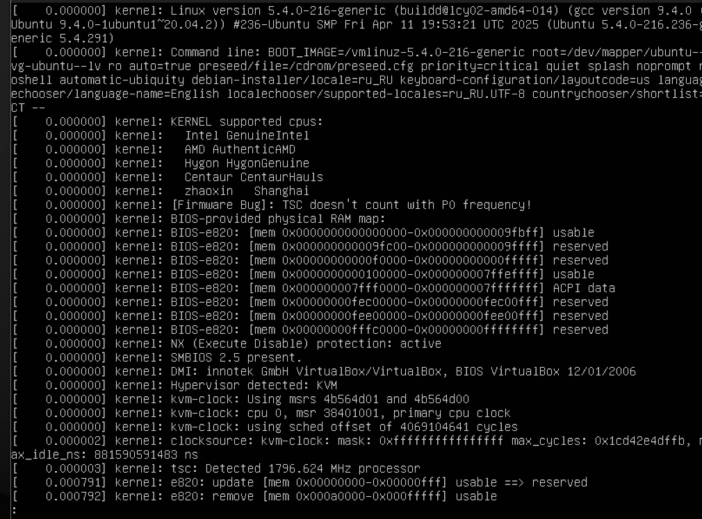

На скриншоте показан журнал `dmesg` с информацией о загрузке ядра и оборудования.

```bash
less /var/log/syslog
```

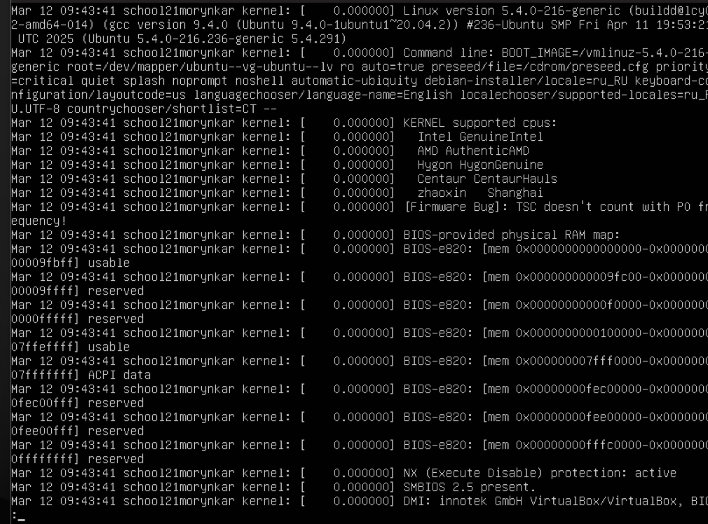

На скриншоте показаны общие системные сообщения из журнала `syslog`.

```bash
less /var/log/auth.log
```


На скриншоте показаны записи о событиях безопасности и авторизации в системе.

* Время последней успешной авторизации: 12 марта, 09:44:20.
* Имя пользователя: `morynkar`.
* Способ входа: `login` (локальная авторизация через терминал).

Перезапустил службу SSH:
```bash
sudo systemctl restart ssh
```
Затем проверил журнал:
```bash
less /var/log/syslog
```


На скриншоте показаны записи `Stopping` и `Started` в `syslog`, подтверждающие остановку и успешный запуск службы OpenBSD Secure Shell.

---
## Part 15. Использование планировщика заданий CRON

**Цель этапа:** настроить периодическое выполнение команды, подтвердить несколько запусков по журналам, а затем корректно удалить временное задание.

С помощью планировщика заданий настроил автоматическое выполнение команды `uptime` каждые две минуты. Для этого открыл таблицу заданий:

```bash
crontab -e
```
Добавил в конец файла строку `*/2 * * * * uptime`.

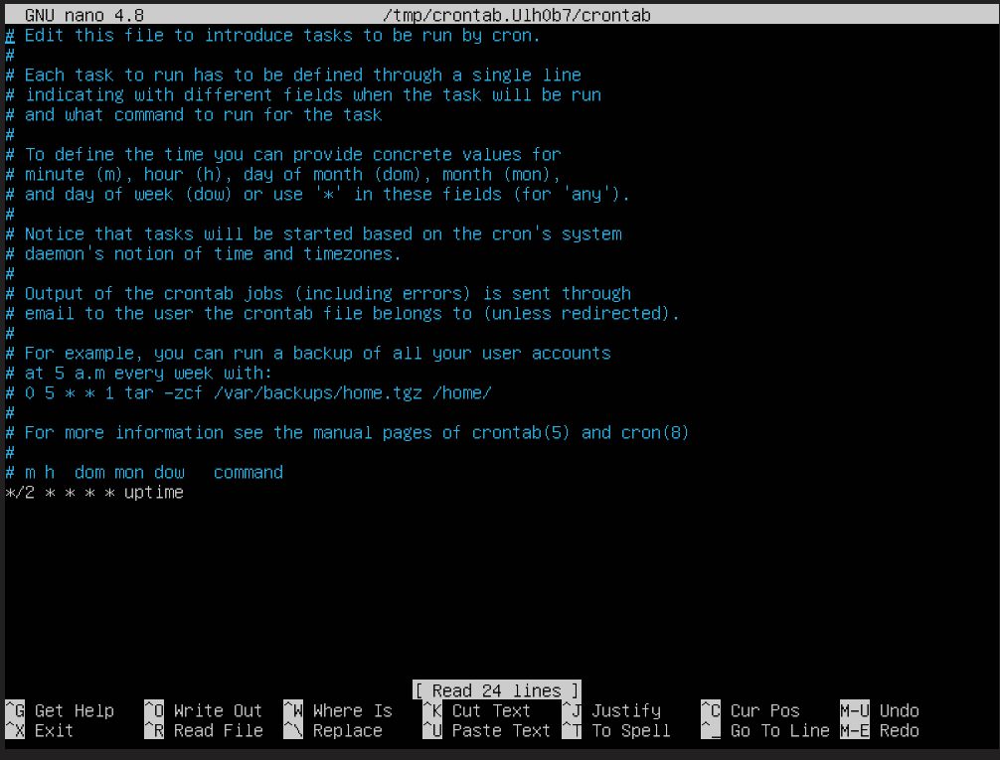

На скриншоте показано редактирование таблицы `crontab` в редакторе Nano.

Вывел список текущих активных заданий для текущего пользователя:

```bash
crontab -l
```


На скриншоте показан список заданий, выведенный командой `crontab -l`.

Просмотрел системные журналы, чтобы убедиться в выполнении задания. В них зафиксированы записи о запуске команды `uptime` через заданные интервалы:


На скриншоте показаны записи в журнале о выполнении задания cron с интервалом в две минуты.

Удалил все текущие задания из планировщика и проверил результат:
```bash
crontab -r
crontab -l
```


На скриншоте показаны удаление заданий и подтверждение отсутствия таблицы `crontab` у пользователя.

---

[↑ К навигации](#навигация) · [← Вернуться в README](../README.md)
