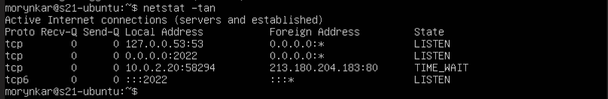
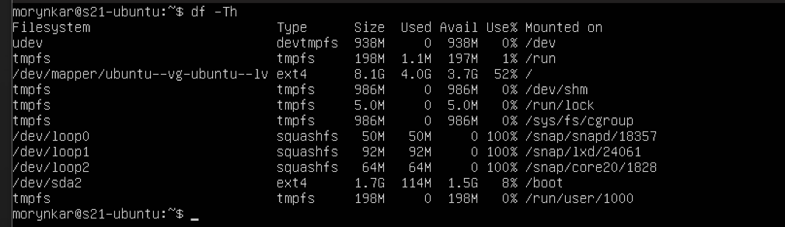
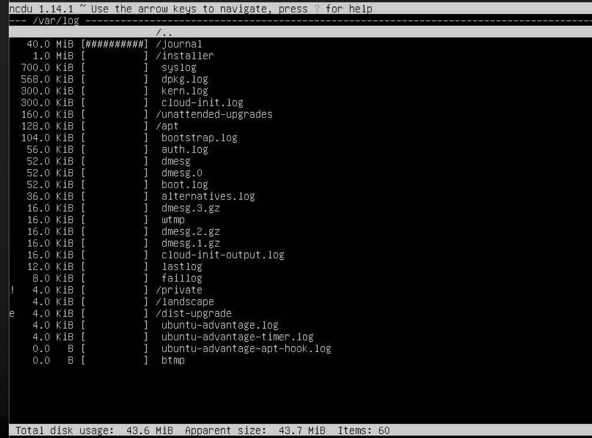
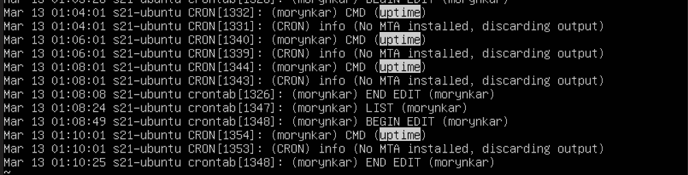

# Технический разбор настройки Linux-сервера

Этот документ описывает выполненную настройку тестовой виртуальной машины. Он не является инструкцией для production-сервера: адреса, имена интерфейсов и параметры доступа необходимо адаптировать под конкретную среду.

## 1. Стенд

В VirtualBox установлена Ubuntu Server 20.04 LTS без графического окружения. Версия системы проверена непосредственно в гостевой ОС:

```bash
cat /etc/issue
```


Такой стенд позволил экспериментировать с сетью и системными службами независимо от основной операционной системы.

## 2. Пользователи и привилегии

Для повседневной работы создан отдельный непривилегированный пользователь. Он добавлен в административную группу и группу `sudo`, после чего состав групп проверен командой `id`:

```bash
sudo adduser user_1
sudo usermod -aG adm,sudo user_1
id user_1
```


Работа через обычную учётную запись уменьшает необходимость постоянного использования `root`. `sudo` предоставляет повышенные права только отдельной команде и оставляет запись о её выполнении в журнале.

Для проверки делегированных прав от имени нового пользователя изменён hostname:

```bash
sudo hostnamectl set-hostname s21-ubuntu
hostnamectl --static
```


## 3. Сеть

Сначала были исследованы доступные интерфейсы, адрес от DHCP и маршрут по умолчанию:

```bash
ip link
ip address
ip route
```

Интерфейс `lo` — программный loopback-интерфейс для обмена данными внутри узла. Основной сетевой интерфейс виртуальной машины получил адрес от DHCP VirtualBox, после чего был переведён на статическую конфигурацию через Netplan.

Обезличенный вариант конфигурации находится в [`configs/netplan.example.yaml`](../configs/netplan.example.yaml). В рабочем стенде были заданы адрес, маршрут по умолчанию и DNS, а DHCP отключён.


Конфигурация применена и проверена после перезагрузки:

```bash
sudo netplan try
sudo netplan apply
ip -brief address
ip route
resolvectl status
```


Связность проверена отдельно по IP-адресу и доменному имени. Это позволяет отличить проблему маршрутизации от проблемы разрешения DNS:

```bash
ping -c 4 1.1.1.1
ping -c 4 ya.ru
```


## 4. Обновления и время

Пакеты обновлены штатным менеджером Ubuntu:

```bash
sudo apt update
sudo apt upgrade
```

Установлен локальный часовой пояс и включена автоматическая синхронизация времени:

```bash
sudo timedatectl set-timezone Asia/Yekaterinburg
sudo timedatectl set-ntp true
timedatectl show --property=Timezone --property=NTPSynchronized
```


## 5. SSH

OpenSSH Server установлен как системная служба и включён в автозагрузку:

```bash
sudo apt install openssh-server
sudo systemctl enable --now ssh
systemctl is-enabled ssh
systemctl is-active ssh
```


Для стенда порт SSH изменён на `2022`. Перед перезапуском синтаксис конфигурации следует проверять командой `sshd -t`, чтобы ошибка не заблокировала удалённый доступ. Обезличенный и усиленный пример настроек приведён в [`configs/sshd_config.example`](../configs/sshd_config.example).


```bash
sudo sshd -t
sudo systemctl restart ssh
ss -lntp | grep ':2022'
```



Адрес `0.0.0.0` в выводе означает, что служба слушает указанный порт на всех IPv4-интерфейсах. Доступ снаружи при этом дополнительно зависит от режима сети VirtualBox и правил межсетевого экрана.

## 6. Процессы и ресурсы

Для оперативной диагностики использованы `top` и `htop`. В `top` исследованы load average за 1, 5 и 15 минут, количество процессов, CPU, память и процессы с наибольшим потреблением ресурсов. Горячие клавиши `Shift+P` и `Shift+M` сортируют список по CPU и памяти соответственно.

В `htop` проверены сортировка, фильтрация процесса `sshd`, поиск системных процессов и настройка информационной панели.


## 7. Диски и файловая система

Разметка диска и swap исследованы командами:

```bash
sudo fdisk -l
swapon --show
```


Использование корневой файловой системы проверено в обычных единицах и человекочитаемом формате:

```bash
df /
df -Th /
```



Размер системных каталогов исследован с помощью `du`, а наиболее крупные элементы — в интерактивном интерфейсе `ncdu`:

```bash
sudo du -sh /home /var /var/log
sudo du -sh /var/log/*
sudo ncdu /var
```




## 8. Журналы

Для диагностики загрузки, системных служб и авторизации исследованы `/var/log/dmesg`, `/var/log/syslog` и `/var/log/auth.log`. В актуальных системах аналогичную информацию удобно получать через `journalctl`.

После перезапуска SSH событие найдено в системном журнале:

```bash
sudo systemctl restart ssh
sudo journalctl -u ssh --since '5 minutes ago'
```


Скриншоты намеренно не включают подробные журналы авторизации: они могут содержать имена пользователей и сетевые адреса.

## 9. Планировщик cron

Для проверки планировщика добавлена временная задача, выполнявшая `uptime` каждые две минуты:

```cron
*/2 * * * * /usr/bin/uptime
```

Факт запуска подтверждён двумя последовательными событиями в системном журнале:



После проверки тестовое задание удалено, а отсутствие активных пользовательских заданий подтверждено повторным вызовом `crontab -l`.


## 10. Итоговая проверка

Ручные проверки объединены в read-only скрипте [`scripts/verify-system.sh`](../scripts/verify-system.sh). Он не меняет систему: выводит версию ОС, hostname, состояние времени, сетевые параметры, DNS, SSH и использование корневой файловой системы.

```bash
sudo ./scripts/verify-system.sh
```

Итогом работы стал изолированный Linux-стенд со статической сетью, синхронизированным временем, управляемым SSH-доступом, средствами мониторинга и проверенной автоматизацией через cron.
