# Полный отчёт по лабораторному стенду

[← Вернуться в README](../README.md)

## Навигация

1. [Установка ОС](#part-1-установка-ос)
2. [Создание пользователя](#part-2-создание-пользователя)
3. [Настройка сети](#part-3-настройка-сети-ос)
4. [Обновление ОС](#part-4-обновление-ос)
5. [Использование sudo](#part-5-использование-команды-sudo)
6. [Синхронизация времени](#part-6-установка-и-настройка-службы-времени)
7. [Текстовые редакторы](#part-7-установка-и-использование-текстовых-редакторов)
8. [Настройка SSH](#part-8-установка-и-базовая-настройка-сервиса-sshd)
9. [Мониторинг процессов](#part-9-установка-и-использование-утилит-top-htop)
10. [Диски и разделы](#part-10-использование-утилиты-fdisk)
11. [Файловая система](#part-11-использование-утилиты-df)
12. [Размер каталогов](#part-12-использование-утилиты-du)
13. [Интерактивный анализ диска](#part-13-установка-и-использование-утилиты-ncdu)
14. [Системные журналы](#part-14-работа-с-системными-журналами)
15. [Планировщик cron](#part-15-использование-планировщика-заданий-cron)

Отчёт сохраняет последовательность выполненной лабораторной работы: цель каждого этапа, использованные команды, наблюдаемое поведение системы и подтверждающие скриншоты. Исходное учебное задание и методические материалы здесь не приводятся.

## Part 1. Установка ОС

**Цель этапа:** подготовить минимальную серверную систему без GUI. Команда `/etc/issue` подтверждает установленный дистрибутив и версию непосредственно внутри виртуальной машины.

С использованием программы виртуализации **VirtualBox** была установлена операционная система **Ubuntu 20.04.6 Server LTS** без графического интерфейса.

Для определения версии установленной системы была выполнена команда:

```
cat /etc/issue
```


На скриншоте: вывод команды cat /etc/issue с версией установленной ОС.


---
## Part 2. Создание пользователя

**Цель этапа:** отделить повседневную работу от учётной записи, созданной при установке, и проверить управление пользователями и группами. Группа `adm` даёт доступ на чтение части системных журналов, но сама по себе не предоставляет полные права `root`.

Был создан новый пользователь `user_1`, отличный от пользователя, созданного при установке системы.

Для создания пользователя была выполнена команда:

```bash
sudo adduser user_1
```
После этого пользователь был добавлен в группу adm:

```bash
sudo usermod -aG adm user_1
```


На скриншоте: процесс создания пользователя user_1 и добавление его в группу adm.

Проверка принадлежности пользователя к группе adm:

```bash
groups user_1
```


На скриншоте: вывод команды groups, подтверждающий наличие user_1 в группе adm.

Далее проверено наличие пользователя в системном файле /etc/passwd:

```bash
cat /etc/passwd
```
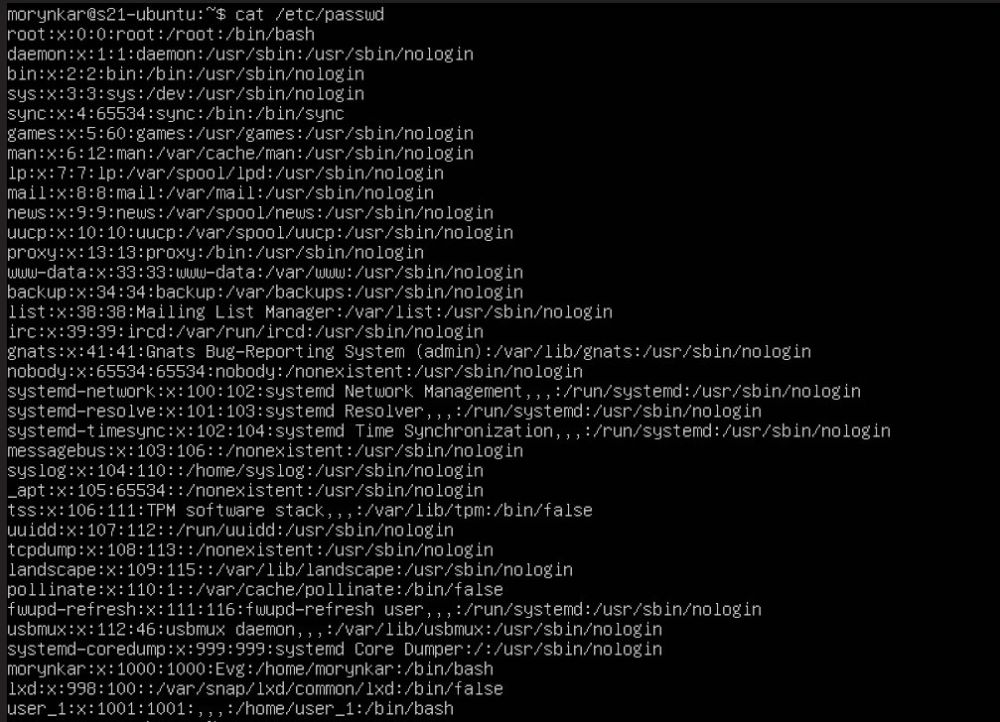

На скриншоте: содержимое файла /etc/passwd с данными нового пользователя.

Есть строка:
`user_1:x:1001:1001::/home/user_1:/bin/bash`
пользователь присутствует в системе

---
## Part 3. Настройка сети ОС

**Цель этапа:** исследовать исходную DHCP-конфигурацию, затем заменить её постоянным IPv4-адресом, шлюзом и DNS. После перезагрузки отдельно проверяются адресация, маршрут по умолчанию, разрешение имён и доступность внешних узлов.

1. Задал название машины вида user-1.
```bash
sudo hostnamectl set-hostname user-1
```


На скриншоте: выполнение команды по смене hostname на user-1.

2. Редактором Vim поправил hosts 
```bash
sudo vim /etc/hosts
```


На скриншоте: содержимое файла /etc/hosts с обновленным именем машины.

3. Установил временную зону, соответствующую моему местоположению.
```bash
timedatectl
sudo timedatectl set-timezone Asia/Yekaterinburg
timedatectl
```


На скриншоте: смена часового пояса и проверка текущего времени через timedatectl.

4. Вывод названия сетевых интерфейсов с помощью консольной команды.
```bash
ip link
```


На скриншоте: список доступных сетевых интерфейсов.

Объяснение наличия интерфейса lo:
- lo — loopback-интерфейс (виртуальный сетевой интерфейс), который используется для обмена данными внутри операционной системы без выхода в физическую сеть.
- Он связан с адресом 127.0.0.1 (localhost). Интерфейс lo создаётся автоматически при загрузке ОС и присутствует в каждой системе Linux.

5. Используя консольную команду, получи ip адрес устройства, на котором ты работаешь, от DHCP-сервера.
```bash
ip a
```
* IP адрес от DHCP 10.0.2.15

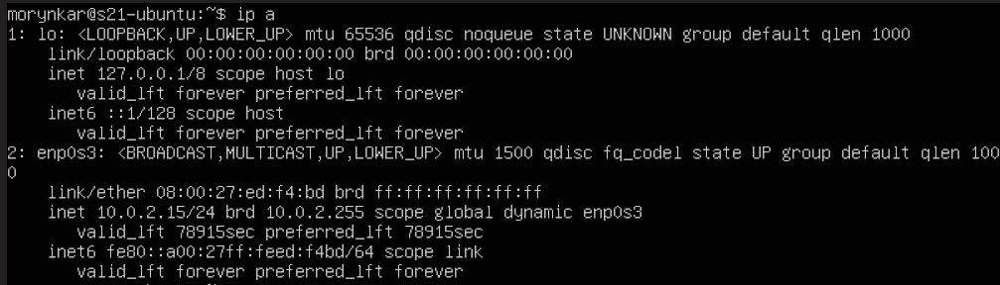

На скриншоте: сетевые настройки интерфейса enp0s3, полученные по DHCP (10.0.2.15).

- DHCP — сетевой протокол, позволяющий сетевым устройствам автоматически получать IP-адрес и другие параметры, необходимые для работы в сети TCP/IP.

6. Определи и выведи на экран внешний ip-адрес шлюза (ip) и внутренний IP-адрес шлюза, он же ip-адрес по умолчанию (gw).
```bash
ip route
curl ifconfig.me
```
* внутренний IP-адрес шлюза 10.0.2.2
* внешний IP-адрес был проверен через внешний сервис и скрыт в публичной версии

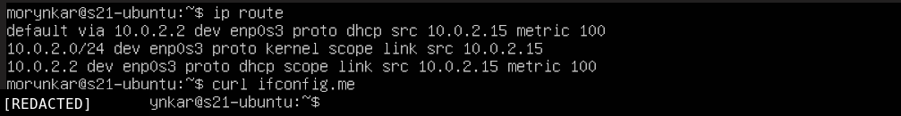

На скриншоте: вывод таблицы маршрутизации (GW 10.0.2.2) и запрос внешнего IP.

7. Задай статичные (заданные вручную, а не полученные от DHCP-сервера) настройки ip, gw, dns (используй публичный DNS-серверы, например 1.1.1.1 или 8.8.8.8).

При помощи текстового редактора Vim был отредактирован файл конфигурации сети:

```bash
sudo vim /etc/netplan/00-installer-config.yaml
```
Заданы статические параметры:
* IP адрес 10.0.2.20/24
* Шлюз по умолчанию (gw) 10.0.2.2
* dns сервер: 1.1.1.1
* dhcp отключен

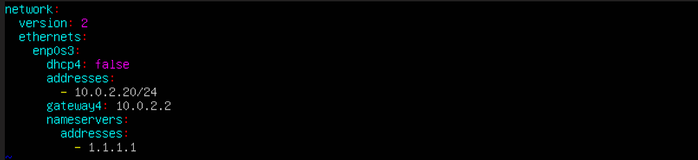

На скриншоте: файл конфигурации со статическим IP 10.0.2.20, шлюзом и DNS.
 
8. Перезагрузи виртуальную машину. Убедись, что статичные сетевые настройки (ip, gw, dns) соответствуют заданным в предыдущем пункте.

После перезагрузки убедился что статичные сетевые настройки применились и соответсвуют заданным в предыдущем пункте:

``` bash
ip a
ip route
```


На скриншоте: проверка актуального статического IP и маршрута по умолчанию.

```bash
resolvectl status enp0s3
```


На скриншоте: проверка настроек DNS-сервера (1.1.1.1).

Успешно пропинговал удаленные хосты `1.1.1.1` и `ya.ru`.

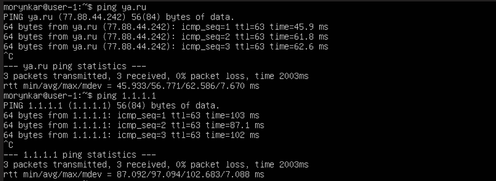

На скриншоте: результат команды ping с фразой «0% packet loss».

---
## Part 4. Обновление ОС

**Цель этапа:** обновить индекс пакетов и установленные компоненты. Повторный запуск позволяет убедиться, что после обновления система не предлагает дополнительных пакетов.
После повторного выполнения команды обновления система вывела сообщение об отсутствии обновлений.
```bash
sudo apt update
sudo apt upgrade -y
```


На скриншоте: системное сообщение «All packages are up to date» после выполнения команды update.


На скриншоте: результат команды upgrade, подтверждающий отсутствие доступных обновлений (0 upgraded).

После обновления системных пакетов, появиться сообщение о том, что обновления отсутствуют.

---
## Part 5. Использование команды sudo

**Цель этапа:** делегировать административную операцию обычному пользователю без постоянного входа под `root`. Выполнение команды через `sudo` проверяется изменением hostname и последующей проверкой результата.
Разрешил пользователю user_1, созданному в Part 2, выполнять команду sudo:
```bash 
sudo usermod -aG sudo user_1
```
Команда sudo позволяет обычному пользователю выполнять команды с правами суперпользователя (root), если у него есть соответствующие разрешения.


На скриншоте: пользователь `user_1` добавлен в группу `sudo`, после чего состав групп проверен командой `groups user_1`.

Поменял hostname ОС от имени пользователя user_1, созданного в пункте Part 2 (используя sudo).

```bash
sudo hostnamectl set-hostname s21-ubuntu
```


На скриншоте: выполнение команды смены hostname под пользователем user_1.

поправил файл `/etc/hosts`

```bash
sudo vim /etc/hosts
```


На скриншоте: обновленное содержимое файла /etc/hosts с новым именем s21-ubuntu.


На скриншоте: приветствие системы при входе, отображающее новый hostname (s21-ubuntu).

---
## Part 6. Установка и настройка службы времени

**Цель этапа:** включить автоматическую коррекцию системного времени. Синхронные часы важны для журналов, cron, сертификатов и сопоставления событий между узлами.

Настроил службу автоматической синхронизации времени и проверил.
```bash
sudo timedatectl set-ntp true
timedatectl show
```
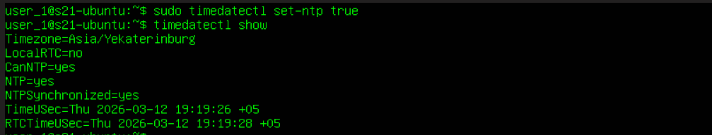

На скриншоте: вывод команды timedatectl show, подтверждающий `NTPSynchronized=yes` и текущее время в моем часовом поясе.

---
## Part 7. Установка и использование текстовых редакторов

**Цель этапа:** сравнить три консольных редактора на одинаковых операциях: создание файла, сохранение, отказ от сохранения, поиск и замена. Это необходимо для изменения конфигураций на сервере без графической среды.
Задание:
1. Установи текстовые редакторы VIM (+ любые два по желанию NANO, MCEDIT, JOE и т. д.)
2. Используя каждый из трех выбранных редакторов, создай файл test_X.txt, где X — название редактора, в котором создан файл. Напиши в нём свой никнейм, закрой файл с сохранением изменений.
3. Используя каждый из трех выбранных редакторов, открой файл на редактирование, отредактируй файл, заменив никнейм на строку «21 School 21», закрой файл без сохранения изменений.
4. Используя каждый из трех выбранных редакторов, отредактируй файл ещё раз (по аналогии с предыдущим пунктом), а затем освой функции поиска по содержимому файла (слово) и замены слова на любое другое.

Установил три текстовых редактора vim, nano и mcedit
```bash
sudo apt update
sudo apt install vim
sudo apt install nano
sudo apt install mcedit
```
Задание в каждом текстовом редакторе написать свой ник:

### 1. Текстовый редактор VIM
#### Создание файла и сохранение:
- Запуск: 
```bash
vim test_vim.txt
```
- Для редактирования нажал клавишу `i` ввел никнейм `morynkar`.
- Для выхода с сохранением: нажал `Esc` и ввел команду `:wq`.


На скриншоте: ввод никнейма и команда сохранения :wq в редакторе VIM.

#### Редактирование без сохранения:
- Переместил курсор к слову с помощью клавиш `h j k l`
- Используя команду `cw` (change word) для удаления слова и перехода в режим вставки, ввел «21 School 21».
- Для выхода без сохранения: нажал Esc и ввел команду :q!.


На скриншоте: содержимое файла после редактирования и команда выхода без сохранения :q!.

#### Поиск и замена:
- Для поиска и замены использовал команду `:s/morynkar/word/` заменяеет `morynkar` на `word`


На скриншоте: ввод команды замены слова в редакторе VIM.

### 2. Текстовый редактор NANO
#### Создание файла и сохранение:
- Запуск:
```bash 
nano test_nano.txt
```
- Полсе редактирования для сохранения нажал `ctrl + O` подтвердил запись в файл и выход `ctrl + X`

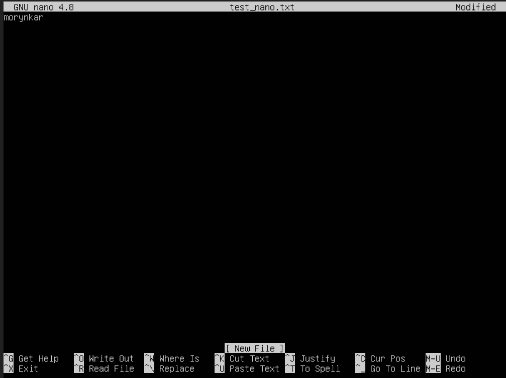

На скриншоте: содержимое файла в редакторе NANO перед сохранением.

#### Редактирование без сохранения:
- Удалил слово кнопкой `del`
- написал "21 school 21"
- нажал сочетание клавишь `Ctrl + x` подтвердил выход
- текстовый редактор предложил сохранить измениея, отказался сочиетанием клавиш `Ctrl + n`


На скриншоте: отредактированный текст в NANO перед закрытием без сохранения.

#### Поиск и замена:
- Для поиска и замены нажал `Ctrl+\`, ввёл искомое слово `morynkar`, затем строку замены `word` и подтвердил операцию.


На скриншоте: ввод слова для поиска в редакторе NANO.


На скриншоте: ввод слова для замены в редакторе NANO.

### 3. Текстовый редактор MCEDIT
- Запуск:
```bash
mcedit test_mcedit.txt
```
- Сохранил внесееные изменения в файл клавишей F2 и вышел из редактора клавишей F10

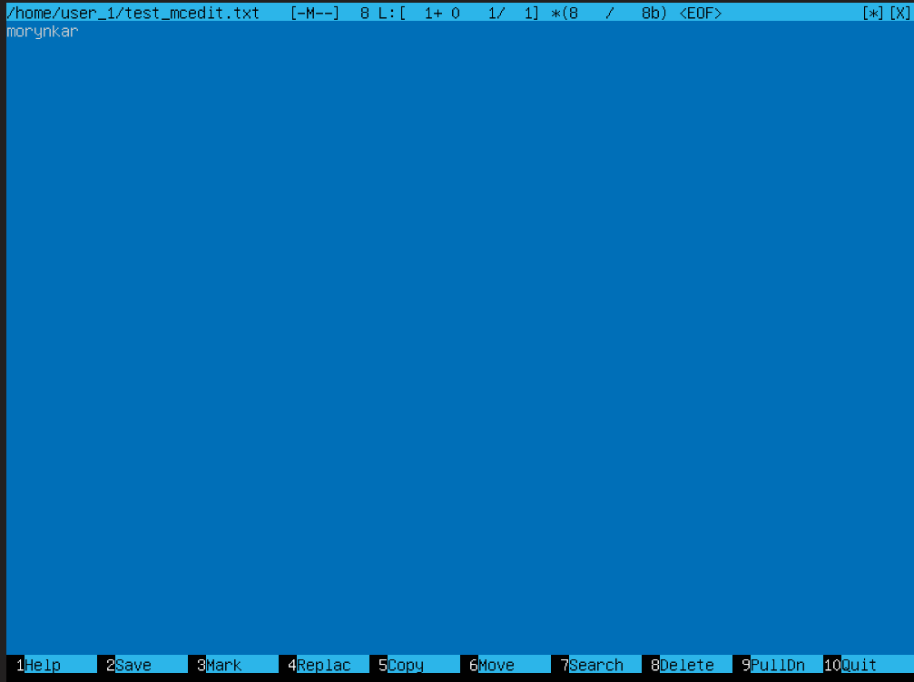

На скриншоте: содержимое файла в редакторе MCEDIT.

#### Редактирование без сохранения:
- Стер слово кнопкой `del`
- написал новое слово `21 school 21`
- нажал клавишу `F10` подтвердил выход
- текстовый редактор предложил сохранить измениея, отказался нажав в меню кнопку `NO`

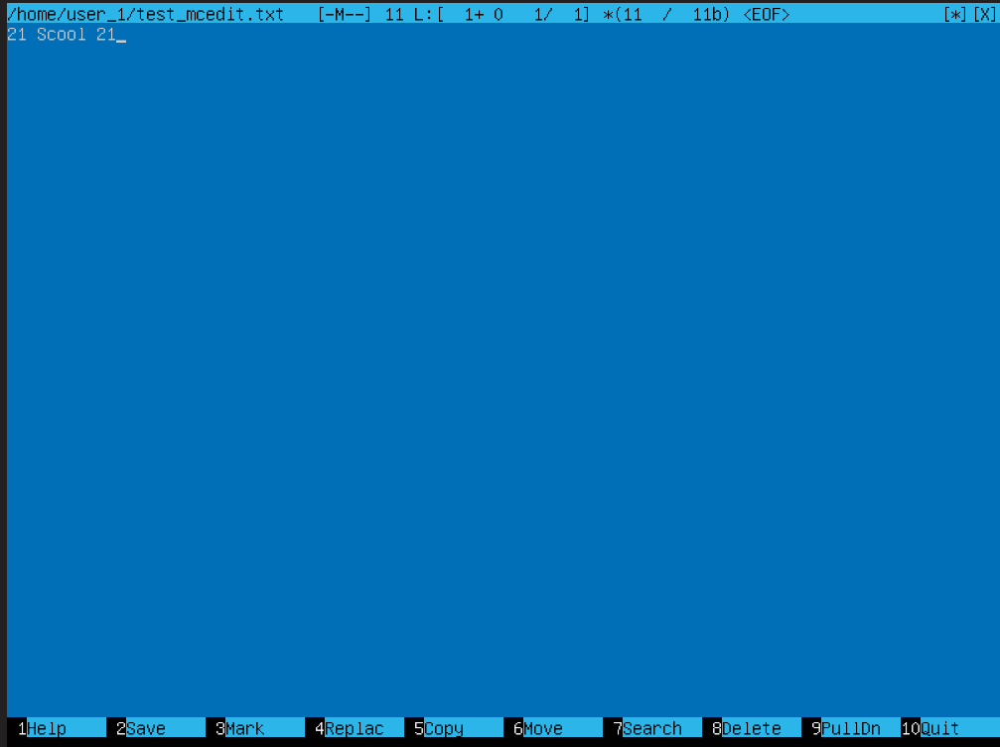

На скриншоте: измененный текст в MCEDIT перед выходом без сохранения.

#### Поиск и замена:

Для поиска и замены: 
- нажал `F4` открылось меню замены слова в поле поиска слова ввел "morynkar" и в поле для замены слова написал "word" и подтвердил нажав `OK`, текстовый редактор выделил заменяемое слово и я нажал `Replace`.


На скриншоте: заполнение полей в окне замены редактора MCEDIT.

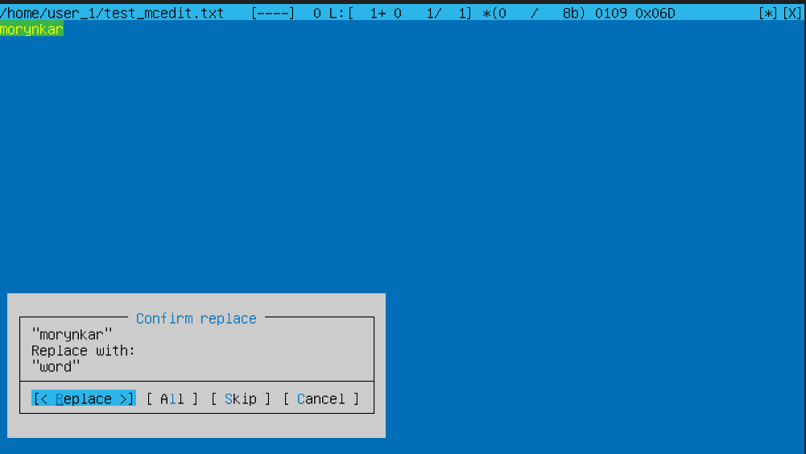

На скриншоте: процесс подтверждения замены слова в MCEDIT.

---
## Part 8. Установка и базовая настройка сервиса SSHD

**Цель этапа:** настроить удалённое администрирование как управляемую systemd-службу. Проверяются установка, автозапуск, изменение порта, наличие процесса и прослушиваемый TCP socket.
Установил службу SSHd.
```bash
sudo apt install openssh-server
```

После установки проверил статус ssh командой 
```bash
sudo systemctl status ssh
```
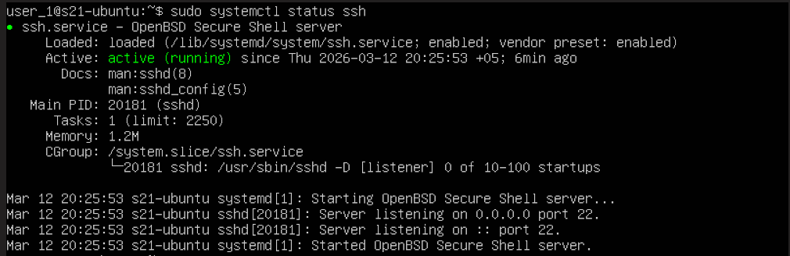

На скриншоте: вывод команды systemctl status, подтверждающий, что служба ssh активна (running).

Включил автозапуск службы ssh командой 
```bash
sudo systemctl enable ssh
``` 
и проверил командой 
```bash
sudo systemctl is-enabled ssh
```


На скриншоте: процесс включения автозагрузки и подтверждение статуса enabled.

для замены port службы ssh с 22 на 2022 открыл конфиг в текстовом редакторе 
```bash 
sudo vim /etc/ssh/sshd_config
```
раскоментировал строку `# Port 22` и исправил на `Port 2022`


На скриншоте: содержимое файла sshd_config с установленным параметром Port 2022.

После изменения конфигурации служба SSH была перезапущена командой: 
```bash
sudo systemctl restart ssh
```

Для проверки наличия процесса службы SSH была использована команда: 
```bash
ps aux | grep sshd
```
* ps - отображает запущенные процессы
* ключи:
    * a - показывает процессы всех пользователей
    * u - выводит подробную информацию о пользователе, запустившего процесс
    * x - показывает процессы не связанные с терминалом
* grep sshd - используется для поиска строк с процессом sshd

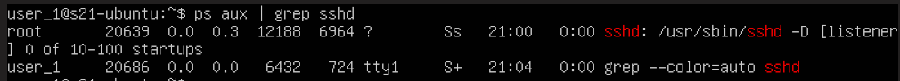

На скриншоте: вывод команды ps aux, подтверждающий работу демона sshd.

После перезагрузки системы команда 
```bash
netstat -tan
``` 
содержит `tcp 0 0.0.0.0:2022 0.0.0.0:* LISTEN`


На скриншоте: вывод netstat, подтверждающий, что порт 2022 находится в состоянии LISTEN.

`netstat` - отображает сетевые соединения.

значение ключей:
* -t - показывает tcp соединения
* -a - показывает все соединения и порты, включая ожидающие подключения
* -n - выводит адреса и порты в числовом виде без преобразования в доменные имена

Значение столбцов netstat
- Proto   - используемый протокол соединения
- Recv-Q  - количество байтов, ожидающих чтения приложением
- Send-Q  - количество байтов, ожидающих отправки приложением
- Local Adres    - локальный IP адрес и порт на которм работает служба
- Foreign Addres - удаленный IP адрес и порт
- State - текущее состояние соединений

Основные состаяния соединений:
- LISTEN      - служба ожидает входящее соединение
- TIME_WAIT   - соединение завершено, но система ждет закрытия
- ESTABLISHED - соединение активно

0.0.0.0 - служба принимает соединения на всех сетевых интерфейсах устройства.

Строка `tcp 0 0.0.0.0:2022 0.0.0.0:* LISTEN` означает, что служба использует TCP, слушает порт 2022 на всех IPv4-интерфейсах и ожидает входящих подключений.

---
## Part 9. Установка и использование утилит top, htop

**Цель этапа:** научиться находить причины нагрузки системы. `top` показывает агрегированные показатели и процессы, а `htop` добавляет интерактивные сортировку, поиск, фильтрацию и настройку панели.
### 1. Работа с утилитой top:
Запуск утилиты top
```bash
top
```

Данные из top:
|параметр|Значение|
|---|---|
|uptime|1 час 13 мин|
|количество авторизованных пользователей|1|
|средняя загрузка за 1, 5 и 15 минут|0.00, 0.00, 0.00|
|общее количество процессов|92|
|Загрузка CPU user|0.0 %|
|Загрузка CPU system|0.0 %|
|Загрузка CPU idle|100 %|
|загрузку памяти|139.3 мб|
|pid процесса занимающего больше всего памяти|656|
|pid процесса, занимающего больше всего процессорного времени|1|

Cортировки столбцов утилиты top
- по загрузке ОЗУ — `Shift+M`
- по загрузке процессора — `Shift+P`

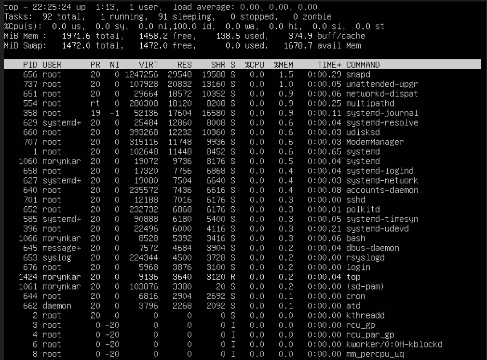

На скриншоте: вывод top, отсортированный по столбцу %MEM (потребление ОЗУ).

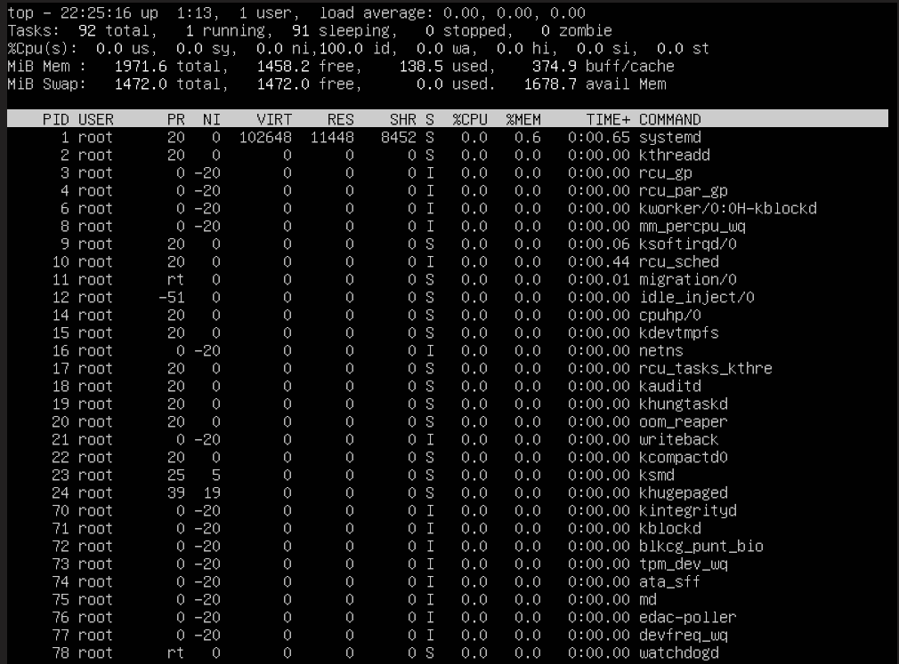

На скриншоте: вывод top, отсортированный по столбцу %CPU (загрузка процессора).

### 2. Работа с утилитой htop:
Запуск утилиты htop
```bash
htop
```
Меню утилиты htop 
- `F6` "SortBy"
- `F4` "Filter"
- `F3` "Serch"
- `F2` "Setup"

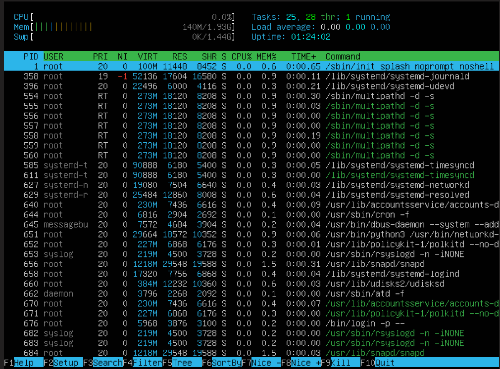

На скриншоте: процессы в htop, отсортированные по значению PID.

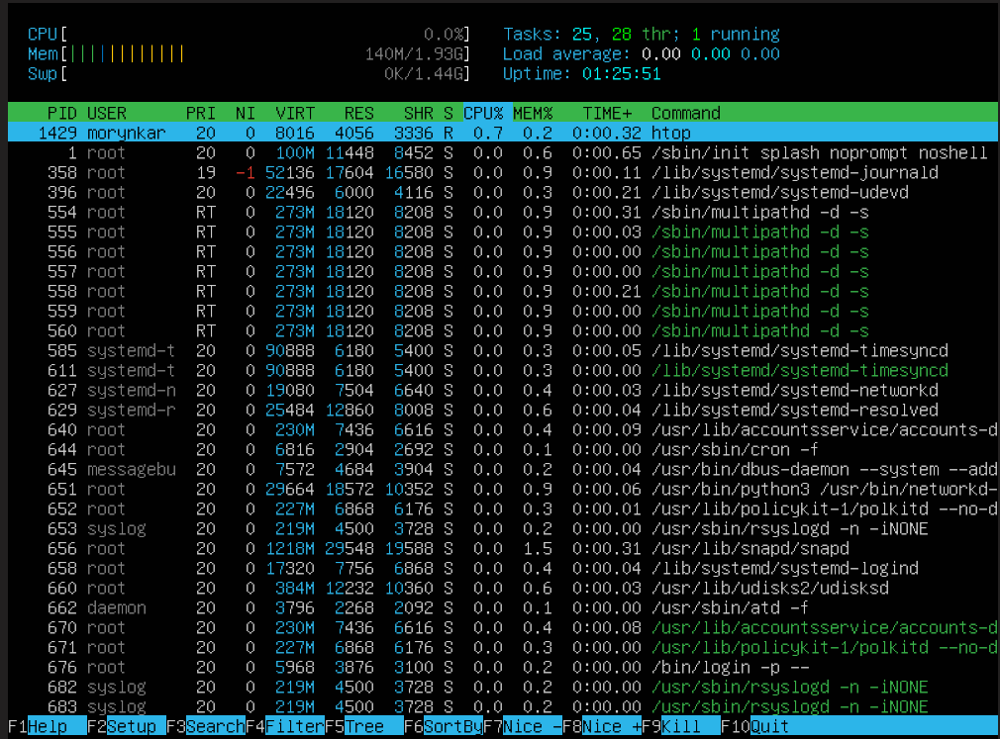

На скриншоте: процессы в htop, отсортированные по PERCENT_CPU.


На скриншоте: процессы в htop, отсортированные по PERCENT_MEM.

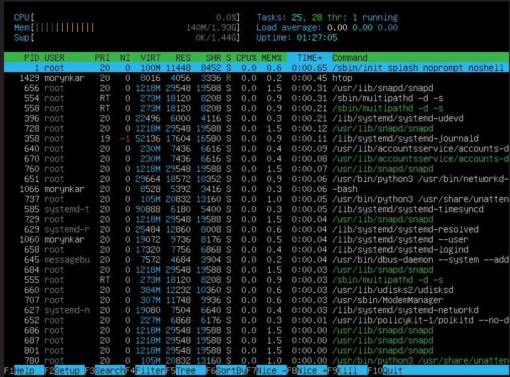

На скриншоте: процессы в htop, отсортированные по времени работы (TIME+).

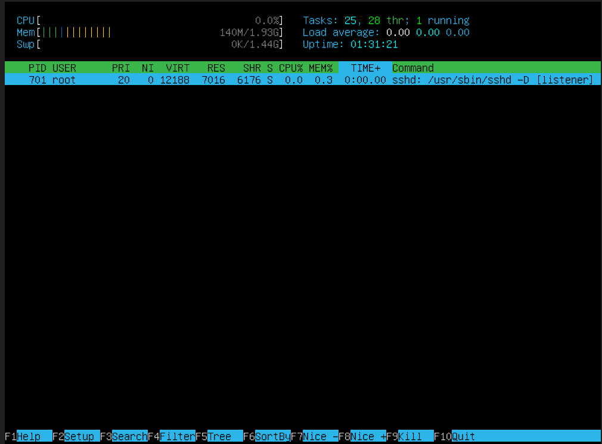

На скриншоте: использование фильтра (F4) для отображения только процессов sshd.

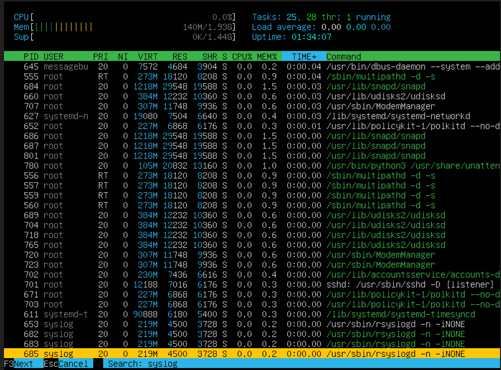

На скриншоте: результат поиска (F3) процесса syslog в общем списке.

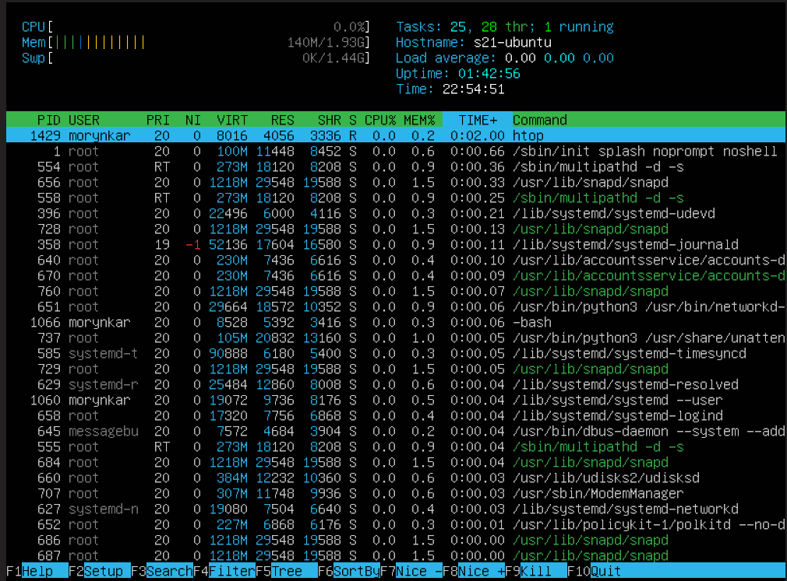

На скриншоте: настроенный заголовок htop (F2) с добавлением полей Hostname, Clock и Uptime.

---
## Part 10. Использование утилиты fdisk

**Цель этапа:** получить информацию о виртуальном диске, его размере, секторах и разделах. `swapon` отдельно показывает подключённое пространство подкачки.
Запустив команду 
```bash
sudo fdisk -l
```

Опредлил: 
- название жесткого диска             /dev/sda 
- размер жесткого диска               10 GiB, 10737418240 bytes
- количество секторов жесткого диска  20971520
```bash
swapon --show
```
- размер swap                         1.4 GiB


На скриншоте: вывод команды fdisk -l с характеристиками диска /dev/sda и информацией о разделах.

---
## Part 11. Использование утилиты df

**Цель этапа:** определить занятое и доступное место на смонтированной корневой файловой системе. Сравниваются блочный и человекочитаемый форматы, а также определяется тип файловой системы.
Заупск утилиты:
```bash
df
```
и запуск утилиты в человекочитаемом формате
```bash
df -Th
```
| Параметр | Значение (df) | Значение (df -Th) |
| --- | --- | --- |
| Размер раздела | 8408452 (1K-blocks) | 8.1 G |
| Занято | 4132456 (1K-blocks) | 4.0 G |
| Свободно | 3827280 (1K-blocks) | 3.7 G |
| Использование | 52% | 52% |
| Тип ФС | - | ext4 |

1K-block — это единица измерения дискового пространства, равная 1024 байтам (1 килобайт).
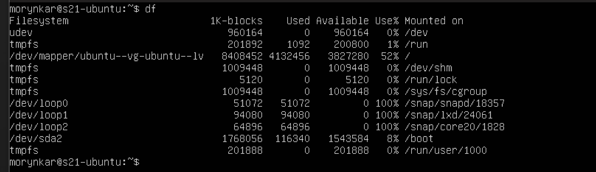

На скриншоте: вывод команды df в стандартном формате.


На скриншоте: вывод команды df -Th с указанием типа ФС и размеров в гигабайтах.

---
## Part 12. Использование утилиты du

**Цель этапа:** измерить место, занимаемое конкретными каталогами и их содержимым. В отличие от `df`, команда `du` анализирует файлы и директории, а не файловую систему целиком.
Используемые ключи:
* -s - показывает тольок итоговый размер
* -b - вывод в байтах
* -h - человекочитаемый формат (KB, MB, GB)

Вывод размер папок /home, /var, /var/log (в байтах и в человекочитаемом виде).
```bash
sudo du -sb /home
sudo du -sh /home
sudo du -sb /var
sudo du -sh /var
sudo du -sb /var/log
sudo du -sh /var/log
```


На скриншоте: итоговые размеры директорий /home, /var и /var/log в байтах и Mb.

Размер всего содержимого в /var/log (не общее, а каждого вложенного элемента, используя *)
```bash
sudo du -sb /var/log/*
sudo du -sh /var/log/*
```


На скриншоте: размеры всех файлов и подпапок внутри /var/log в байтах.

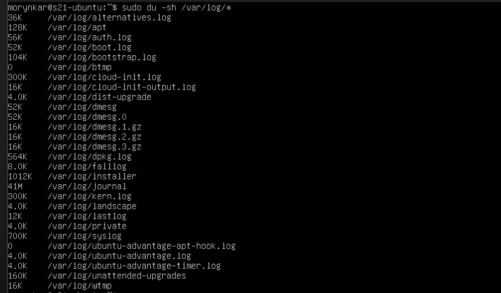

На скриншоте: размеры вложенных элементов /var/log в формате Kb и Mb.

---
## Part 13. Установка и использование утилиты ncdu

**Цель этапа:** повторить анализ каталогов в интерактивном интерфейсе и сопоставить результат с `du`. Это облегчает поиск крупных файлов и подкаталогов.

установка утилиты ncdu
```bash
sudo apt install ncdu
```
запуск утилиты 
```bash
ncdu /
```


На скриншоте: интерактивное дерево каталогов в ncdu, отображающее размеры папок /home, /var и других системных директорий.

- C помощью навигации (клавиши управления курсором) перешел в каталог /var/log для анализа занимаемого пространства каждым файлом:


На скриншоте: детальный просмотр содержимого /var/log в ncdu с сортировкой элементов по размеру.

Результаты `ncdu` приблизительно совпадают с `du`: `/var` занимает около 1,4 GiB, а `/var/log` — около 40 MiB. Небольшая разница возможна из-за округления единиц, изменения журналов между замерами и различий в подсчёте видимого и фактически занятого дискового пространства.

---
## Part 14. Работа с системными журналами

**Цель этапа:** найти сведения о загрузке ядра, общесистемных событиях и авторизации. После перезапуска SSH запись в журнале подтверждает, что действие действительно обработано systemd.

Для удобного прокурчивания журнал открывал через `less`

```bash
less /var/log/dmesg
```


На скриншоте: содержимое журнала dmesg с информацией о загрузке ядра и аппаратного обеспечения.

```bash
less /var/log/syslog
```


На скриншоте: общие системные сообщения в журнале syslog.

```bash
less /var/log/auth.log
```

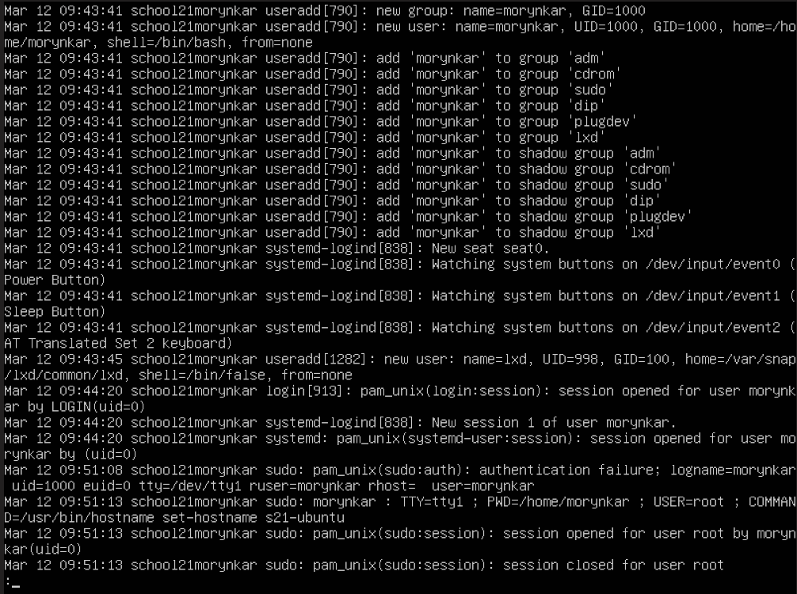

На скриншоте: записи о событиях безопасности и авторизации в системе.

* Время последней успешной авторизации: 12 марта 09:44:20
* имя пользователя: morynkar
* метод входа: login (локальная авторизация через терминал)

Перезапуск службы ssh 
```bash
sudo systemctl restart ssh
```
после этого проверка в 
```bash
less /var/log/syslog
```


На скриншоте: записи в syslog о завершении (Stopping) и успешном запуске (Started) службы OpenBSD Secure Shell server.

---
## Part 15. Использование планировщика заданий CRON

**Цель этапа:** настроить периодическое выполнение команды, подтвердить несколько запусков по журналам, а затем корректно удалить временное задание.

С помощью планировщика заданий настроил автоматическое выполнение команды uptime каждые 2 минуты. Для этого открыл файл конфигурации:

```bash
crontab -e
``` 
Добавил в конец файла строку: `*/2 * * * * uptime`


на скриншоте: редактирование файла crontab в текстовом редакторе nano.

Вывел список текущих активных заданий для текущего пользователя:

```bash
crontab -l
```

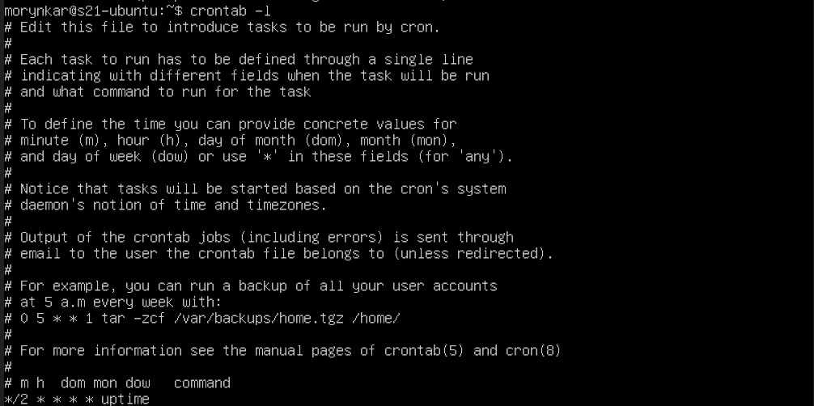

На скриншоте: просмотр текущих задач планировщика командой crontab -l.

Просмотрел системные логи, чтобы убедиться в выполнении задания. В журнале зафиксированы записи о выполнении команды uptime в заданные интервалы:


На скриншоте: записи в логах о выполнении задания CRON с интервалом в 2 минуты.

Удалил все текущие задания из планировщика и проверил результат:
```bash
crontab -r
crontab -l
```


На скриншоте: выполнение команды удаления заданий и подтверждение отсутствия crontab для пользователя.

---

[↑ К навигации](#навигация) · [← Вернуться в README](../README.md)
